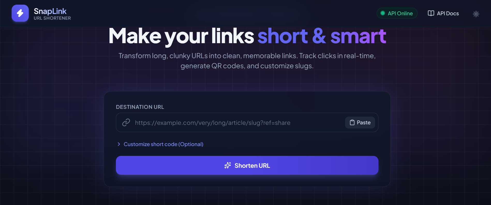
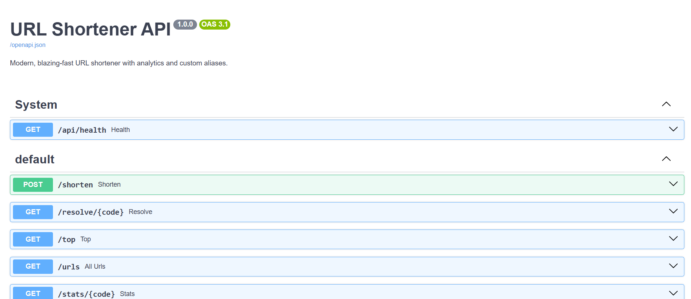

# 🔗 URL Shortener

A fast and simple **URL shortener web application** built with **FastAPI** and **SQLite**. It turns long links into short codes, redirects visitors to the original address, and tracks how many times each link is clicked.

---

## 🎯 Objectives

- Build a working URL shortener with a REST API, a database and a web dashboard
- Practice team collaboration using **Git and GitHub**
- Learn branching, commits, pull requests, code reviews and merge-conflict resolution

---

## 👥 Team Members and Contributions

| Member | GitHub | Contribution |
|--------|--------|--------------|
| Pulkit Bhagat | [pulkit-b07](https://github.com/pulkit-b07) | Repository setup, shorten + resolve + top links (`shortener.py`), `index.html`, `app.js`, `CONTRIBUTING.md` |
| Ankit Bisht | [codeforlegacy](https://github.com/codeforlegacy) | List + search, stats, update and delete features, `database.py`, `style.css`, `README.md` |

---

## ✨ Features

- **Shorten** any long URL into a random 6-character code
- **Custom aliases**: choose your own short code (rejects codes already in use)
- **Redirect** a short link to its original URL
- **Click tracking** for every link
- **Top links**: see the most-clicked URLs
- **List and search** all links by short code or original URL
- **Stats** for each link (clicks, creation time)
- **Edit** where a short link points, keeping the same code
- **Delete** a short link
- **Interactive API docs** (Swagger UI) at `/docs`
- **Web dashboard** served from the same app

---

## 🛠️ Technologies

| Area | Technology |
|------|------------|
| Language | Python 3 |
| Backend framework | FastAPI |
| Server | Uvicorn |
| Validation | Pydantic |
| Database | SQLite (`urls.db`, created automatically) |
| Frontend | HTML, CSS, JavaScript |

---

## 📁 Project Structure

```
Url-Shortener/
├── main.py            # FastAPI app and API routes
├── shortener.py       # Business logic (create, resolve, list, stats, update, delete)
├── database.py        # SQLite connection and table creation
├── index.html         # Dashboard page
├── style.css          # Dashboard styling
├── app.js             # Dashboard logic
├── requirements.txt   # Python dependencies
├── README.md          # Project documentation
├── CONTRIBUTING.md    # Contribution guidelines
└── static/            # Created automatically; holds copies of the frontend files
```

---

## ⚙️ Installation

1. **Clone** the repository:

   ```bash
   git clone https://github.com/pulkit-b07/Url-Shortener.git
   cd Url-Shortener
   ```

2. **(Optional) Create a virtual environment:**

   ```bash
   python -m venv venv
   venv\Scripts\activate
   ```

3. **Install the dependencies:**

   ```bash
   pip install -r requirements.txt
   ```

---

## ▶️ How to Run

Start the server:


 with Uvicorn directly:

```bash
uvicorn main:app --reload
```

Then open these in your browser:

- **Dashboard:** <http://127.0.0.1:8000>
- **API docs (Swagger):** <http://127.0.0.1:8000/docs>

The database file `urls.db` is created automatically on first run.

---

## 🌐 API Endpoints

| Method | Endpoint | Description |
|--------|----------|-------------|
| `GET` | `/` | Open the dashboard |
| `GET` | `/api/health` | Check that the API is running |
| `POST` | `/shorten` | Create a short link (optional `custom_code`) |
| `GET` | `/resolve/{code}` | Get the original URL as JSON and add 1 click |
| `GET` | `/top?limit=5` | Most-clicked links |
| `GET` | `/urls?search=word` | List all links, optionally filtered |
| `GET` | `/stats/{code}` | Statistics for one link |
| `PUT` | `/urls/{code}` | Change the URL a code points to |
| `DELETE` | `/urls/{code}` | Delete a short link |
| `GET` | `/{code}` | Redirect to the original URL |

**Example: shorten a URL**

```bash
curl -X POST http://127.0.0.1:8000/shorten \
  -H "Content-Type: application/json" \
  -d '{"url": "https://www.example.com/very/long/link", "custom_code": "demo"}'
```

**Sample response**

```json
{
  "code": "demo",
  "short_url": "http://127.0.0.1:8000/demo"
}
```

---

## 🖼️ Screenshots

### Dashboard



### API Documentation



---

## 🔀 Git Workflow Used

1. Work on separate branches: `feature-member1` and `feature-member2`
2. Make small, clear commits
3. Open **pull requests** into `main`
4. **Review** each other's pull requests
5. Resolve **merge conflicts** when merging into `main`

---

## 🤝 Contributing

See [CONTRIBUTING.md](CONTRIBUTING.md) for guidelines.

---

## 📄 Links

- [Repository](https://github.com/pulkit-b07/Url-Shortener)
- [FastAPI documentation](https://fastapi.tiangolo.com/)
- [SQLite documentation](https://www.sqlite.org/docs.html)
